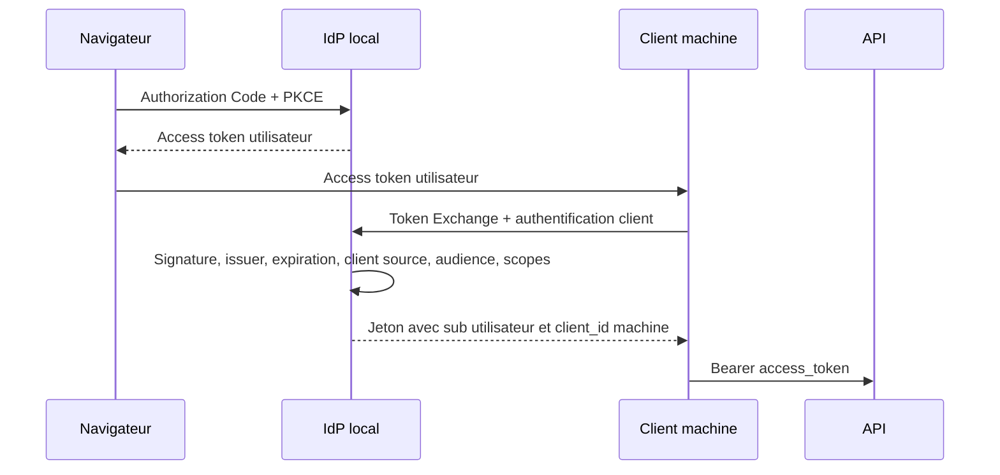

# Token Exchange avec un utilisateur du même IdP

[Documentation](README.md) · [Clients](clients.md) · [Projections](projections.md)

Cette fonctionnalité est disponible depuis `0.1.0-alpha.2`. Elle n'est pas incluse dans les archives NuGet `0.1.0-alpha.1` déjà publiées. Pour l'essayer avant publication, construis les [packages locaux](developpement.md).

## Parcours pris en charge

Un utilisateur se connecte par Authorization Code + PKCE. Un client machine du même fournisseur présente ensuite son access token au token endpoint, avec son propre secret ou son assertion `private_key_jwt`. Le fournisseur délivre un nouveau jeton pour l'API autorisée, avec le même `sub`, l'identité du client machine et les informations utilisateur sélectionnées.

Le terme « trusted device » désigne ici cette autorisation d'agir pour l'utilisateur. Le projet ne fournit pas d'enregistrement matériel, de preuve d'intégrité du terminal ni de confiance persistante après expiration du jeton.

L'échange utilise le grant standard [OAuth Token Exchange, RFC 8693](https://www.rfc-editor.org/rfc/rfc8693.html), via le mécanisme d'[extension grant Duende](https://docs.duendesoftware.com/identityserver/tokens/extension-grants/). Le client machine continue aussi à accepter `grant_type=client_credentials`, qui délivre un jeton sans utilisateur. La requête d'échange utilise `grant_type=urn:ietf:params:oauth:grant-type:token-exchange`.



## Configuration dans l'AppHost

Extrait supposant une ressource Aspire `web` existante avec un endpoint `https` :

```csharp
var idp = builder.AddIdentityServer("idp")
    .WithTestUser("alice", "alice", "Alice");
var ordersApi = idp.AddApiResource("orders-api")
    .WithScopes("orders.read", "orders.write");
var browser = idp.AddAuthorizationCodeClient("web")
    .WithGeneratedPrivateKeyJwt()
    .WithScopes("openid", "profile", "orders.read")
    .WithRedirectUri(web.GetEndpoint("https"), "/signin-oidc");
var worker = idp.AddClientCredentialsClient("device")
    .WithGeneratedPrivateKeyJwt()
    .WithScopes("orders.read")
    .WithTokenExchangeFrom(browser, ordersApi, userClaims: ["name"]);

web.WithIdentityClient(browser, "Authentication:Corporate")
    .WithIdentityClient(worker, "TokenExchange:Device");
```

Une seule méthode active l'échange. Tu peux remplacer `WithGeneratedPrivateKeyJwt()` par `WithGeneratedClientSecret()` ou réutiliser les variantes de credentials fournis. PKCE concerne le parcours utilisateur ; l'authentification du client machine demeure obligatoire.

| Argument | Rôle |
| --- | --- |
| `subjectClient` / `browser` | Client Authorization Code autorisé à fournir le jeton utilisateur. |
| `api` / `ordersApi` | Audience obligatoire du jeton source et du jeton demandé. La V1 conserve cette audience. |
| `userClaims` | Noms des informations utilisateur autorisées en sortie. Vide par défaut. |

`sub` est toujours conservé et ne figure pas dans `userClaims`. Le profil de test local fournit les informations sélectionnées : `WithTestUser` renseigne actuellement `name`. Demander un champ absent du profil ne le crée pas. Les champs de protocole (`iss`, `sub`, `aud`, `scope`, `exp`, `act`, etc.) ne peuvent pas être injectés comme informations utilisateur.

Chaque association client source / API est explicite. Plusieurs appels permettent d'autoriser plusieurs associations ; un doublon est refusé. Tous les objets doivent appartenir au même IdP. La configuration refuse au démarrage les associations sans scope API partagé entre le navigateur, le client machine et l'API.

Déclare les credentials et toutes les règles d'échange avant d'appeler `WithIdentityClient`, afin que la projection standard sélectionne les champs correspondants.

## Projections et configuration effective

Le consommateur reçoit les mêmes champs qu'un client machine normal : `Authority`, `ClientId`, `AuthenticationMethod`, `Scopes`, puis `PrivateKeyPem`/`KeyId`, `PrivateKeyBase64`/`KeyId` ou `ClientSecret`. La projection standard ajoute `TokenExchangeAudience` si toutes les règles sélectionnent la même API. Le helper réutilise cette valeur, sans recopier une audience dans le code consommateur. Les clés privées restent des paramètres secrets Aspire et l'autorité reste une référence différée d'endpoint. Voir le [contrat JWK Base64](jwk-base64.md).

Si un client autorise plusieurs audiences différentes, le champ automatique est absent : passe l'audience voulue au helper. Le mapping personnalisé expose aussi `projection.TokenExchangeAudience("MaSection:Audience")` ; demander ce champ sans audience unique provoque une erreur explicite.

Le réglage supplémentaire est envoyé uniquement au processus fournisseur, sous le client machine correspondant :

```text
IdentityServer__Clients__<index>__TokenExchanges__0__SubjectClientId=web
IdentityServer__Clients__<index>__TokenExchanges__0__Audience=orders-api
IdentityServer__Clients__<index>__TokenExchanges__0__UserClaims__0=name
```

`<index>` dépend de l'ordre d'enregistrement des clients. Aucun jeton utilisateur n'est stocké dans cette configuration. Le consommateur obtient le jeton à l'exécution, par exemple dans les tokens sauvegardés par son handler OIDC.

## Appeler l'API avec un HttpClient nommé

Le package `TheDotSide.Aspire.IdentityServer.Client` fournit `AddTokenExchangeHandler`. L'extension s'applique uniquement au client nommé choisi. Les autres clients créés par `IHttpClientFactory` continuent de fonctionner normalement.

Exemple ASP.NET Core avec le schéma de cookie `cookie-a` du [sample web](../samples/Sample.Web/Program.cs). Adapte ce nom à ton handler d'authentification. L'application doit conserver l'access token du parcours OIDC, par exemple avec `SaveTokens = true`.

```csharp
using Aspire.IdentityServer.Client;
using Microsoft.AspNetCore.Authentication;

builder.Services.AddHttpContextAccessor();
builder.Services.AddHttpClient("orders", client =>
{
    client.BaseAddress = new Uri(builder.Configuration["services:api:https:0"]!);
}).AddTokenExchangeHandler(
    builder.Configuration.GetSection("TokenExchange:Device"),
    options =>
    {
        options.SubjectTokenProvider = async (services, request, cancellationToken) =>
        {
            cancellationToken.ThrowIfCancellationRequested();
            var context = services.GetRequiredService<IHttpContextAccessor>().HttpContext;
            return context is null
                ? null
                : await context.GetTokenAsync("cookie-a", "access_token");
        };
    });
```

Dans l'AppHost, une ressource API `api` est exposée au web avec `web.WithReference(api)`. L'adresse de l'API, comme les credentials du client machine, est résolue par Aspire.

Le service métier ne connaît pas la mécanique d'échange :

```csharp
using var http = httpClientFactory.CreateClient("orders");
using var response = await http.GetAsync("/orders/a", cancellationToken);
response.EnsureSuccessStatusCode();
```

À chaque requête, le handler lit le jeton utilisateur, découvre le token endpoint, effectue l'échange et place le nouveau Bearer sur l'appel API. Le backchannel nommé `TokenExchangeHttpClientExtensions.BackchannelClientName` n'utilise pas ce handler : ni récursion ni propagation des credentials machine à l'API. Configure une adresse de ressource HTTPS ; ne fixe pas de header `Authorization` sur ce client, car le handler refuse de remplacer une authentification existante.

Les options facultatives `Audience` et `Scope` permettent de choisir un sous-ensemble explicite. Par défaut, elles utilisent `IdentityClientOptions.TokenExchangeAudience` et `Scopes` projetés depuis l'AppHost. Le sample utilise `options.Scope = "orders.read"` sur ses deux clients nommés.

Le handler ne stocke aucun jeton utilisateur ou résultat d'échange en cache. Son callback est appelé au moment de l'envoi. Le `IServiceProvider` fourni appartient au scope du handler, qui peut être partagé entre des requêtes : récupère `IHttpContextAccessor` et lis son contexte courant. Pour un service propre à la requête, utilise `context.RequestServices`. Ne capture ni `HttpContext`, ni utilisateur, ni jeton pendant l'enregistrement du client. Cette distinction suit les [règles de portée de IHttpClientFactory](https://learn.microsoft.com/en-us/dotnet/core/extensions/http-client#message-handler-scopes-in-ihttpclientfactory).

Sans contexte ASP.NET Core, le callback est facultatif. Donne le jeton à la requête :

```csharp
builder.Services.AddHttpClient("orders")
    .AddTokenExchangeHandler(builder.Configuration.GetSection("TokenExchange:Device"));

using var request = new HttpRequestMessage(HttpMethod.Get, "https://<api>/orders/a");
request.Options.Set(TokenExchange.SubjectTokenKey, userAccessToken);
using var http = httpClientFactory.CreateClient("orders");
using var response = await http.SendAsync(request, cancellationToken);
```

Sans jeton utilisateur, l'envoi est refusé avant de contacter l'API. Aucun repli automatique vers un token purement machine n'est effectué. Les annulations sont propagées, et le Bearer temporaire est retiré de l'objet requête après l'envoi. Un appel ultérieur ou une nouvelle tentative crée une nouvelle assertion client. Le handler reste indépendant d'ASP.NET Core et de Duende : la résolution du jeton utilisateur appartient au consommateur.

## Construire une requête d'échange explicitement

Le package facultatif `TheDotSide.Aspire.IdentityServer.Client` fournit un helper indépendant du moteur. Dans un service disposant d'un `IConfiguration configuration`, d'un `IHttpClientFactory factory` et d'un `CancellationToken cancellationToken` :

```csharp
using System.Net.Http.Json;
using System.Text.Json;
using Aspire.IdentityServer.Client;

var machine = configuration.GetSection("TokenExchange:Device")
    .Get<IdentityClientOptions>()!;
var http = factory.CreateClient();
var metadata = await http.GetFromJsonAsync<JsonElement>(
    machine.Authority + "/.well-known/openid-configuration",
    cancellationToken);
var tokenEndpoint = metadata.GetProperty("token_endpoint").GetString()!;

// userAccessToken vient du parcours Authorization Code de browser.
using var request = TokenExchange.CreateRequest(
    machine, tokenEndpoint, userAccessToken);
using var response = await http.SendAsync(request, cancellationToken);
response.EnsureSuccessStatusCode();
var exchanged = await response.Content.ReadFromJsonAsync<JsonElement>(cancellationToken);
var accessToken = exchanged.GetProperty("access_token").GetString();
```

Le helper construit une requête HTTP et ne l'envoie pas. Il exige un endpoint HTTPS, prend en charge les deux méthodes d'authentification et crée une nouvelle assertion avec un nouveau `jti` à chaque appel. Utilise une nouvelle requête pour chaque tentative. Sans argument `scope`, il demande les scopes projetés du client machine ; indique un sous-ensemble si nécessaire, par exemple `TokenExchange.CreateRequest(machine, tokenEndpoint, userAccessToken, scope: "orders.read")`. Une audience peut aussi être fournie explicitement avec `audience: "orders-api"`.

Sans ce package, envoie un formulaire `application/x-www-form-urlencoded` au token endpoint :

```text
grant_type=urn:ietf:params:oauth:grant-type:token-exchange
client_id=device
subject_token=<access-token-utilisateur>
subject_token_type=urn:ietf:params:oauth:token-type:access_token
requested_token_type=urn:ietf:params:oauth:token-type:access_token
audience=orders-api
scope=orders.read
client_assertion_type=urn:ietf:params:oauth:client-assertion-type:jwt-bearer
client_assertion=<nouvelle-assertion-client>
```

Avec un secret, remplace les deux champs `client_assertion*` par `client_secret`. Un code d'autorisation ou un ID token ne convient pas comme `subject_token`.

## Résultat et limites

La réponse contient `access_token`, `token_type=Bearer`, `issued_token_type=urn:ietf:params:oauth:token-type:access_token`, `expires_in` et `scope`. Elle ne contient ni refresh token ni ID token.

Le jeton signé porte notamment :

| Claim | Valeur de l'exemple |
| --- | --- |
| `iss` | Issuer HTTPS de l'IdP local. |
| `sub` | Sujet du jeton utilisateur, par exemple `idp:alice`. |
| `client_id` | `device`. |
| `act` | Objet JSON `{ "sub": "device" }`, identifiant du client qui agit pour l'utilisateur. |
| `aud` | `orders-api`. |
| `scope` | `orders.read`. |
| `name` | `Alice`, uniquement si sélectionné. |
| `auth_time` | Heure d'authentification du jeton source. |
| `amr` | Méthodes d'authentification du jeton source, par exemple `pwd`. L'échange ne les remplace pas. |
| `idp` | Fournisseur d'identité du jeton source, `local` pour les utilisateurs de test. |

Les scopes demandés doivent appartenir au client machine, à l'API et au jeton utilisateur. Le jeton échangé ne peut pas prolonger la validité du jeton source. Une marge d'une seconde évite de prolonger sa validité pendant l'émission ; un jeton trop proche de son expiration est refusé.

Si un scope demandé désigne plusieurs ressources API du même fournisseur, l'échange est refusé plutôt que d'émettre des audiences supplémentaires. Utilise des scopes distincts pour les API cibles dans cette V1.

Une audience qu'aucune politique du client machine n'autorise renvoie `invalid_target`, comme le recommande la RFC 8693. Une audience autorisée avec un jeton source inattendu renvoie `invalid_grant`.

Le fournisseur refuse les jetons mal signés, expirés, provenant d'un autre issuer, sans utilisateur actif, issus d'un client source non autorisé, ainsi que les ID tokens et les jetons purement machine. Il refuse aussi, en `invalid_grant`, un jeton lié à une clé par DPoP ou mTLS (claim `cnf`) : l'échange émettrait un jeton porteur sans preuve de possession. Les échanges en chaîne, `actor_token`, `resource`, plusieurs audiences et les types de jeton autres que l'access token sont exclus de cette V1. `subject_token` et `actor_token` sont masqués dans les journaux de requête Duende.

Un access token utilisateur peut servir à plusieurs échanges tant qu'il reste valide. Une assertion `private_key_jwt` ne peut pas être rejouée. La déconnexion navigateur ne révoque pas les access tokens déjà émis ; leur expiration reste applicable.

Le [sample AppHost](../samples/Sample.AppHost/Program.cs) montre un client RSA autorisant `name` et un client avec secret sans claim utilisateur supplémentaire. Les [tests réels](../tests/Aspire.IdentityServer.DistributedTests/TokenExchangeTests.cs) couvrent les parcours PKCE, l'authentification du client machine, l'acceptation du jeton par l'API et les refus.

## Étape suivante : deux IdP

Le scénario IdP2 → IdP1 est décrit dans le [suivi de la phase 2](roadmap/token-exchange-cross-idp.md). Il sera implémenté après validation du parcours local. La V1 rejette explicitement cette configuration et les jetons étrangers.

Le runtime reste exclusivement destiné au développement et aux tests locaux. Les contrats de projection ne rendent pas le fournisseur déployable sur Kubernetes.
